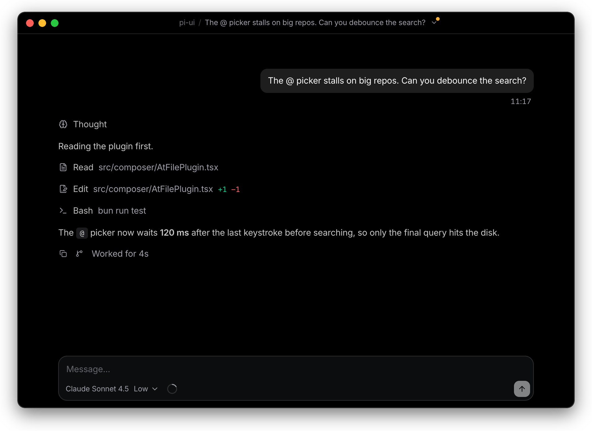

# Pi Dot

**A beautifully designed desktop app for the [pi](https://github.com/earendil-works/pi) coding agent.**

  

- **A polished interface**: consistent dark and light themes, restrained typography, careful details.
- **Plans as documents**: Plan Mode presents the plan as a document. Select text to comment, then build with one click.
- **Works with `pi`**: shares configuration and sessions in `~/.pi/agent`, so you can pick up the same session in the terminal or the desktop.

> Early development. No packaged releases yet.
