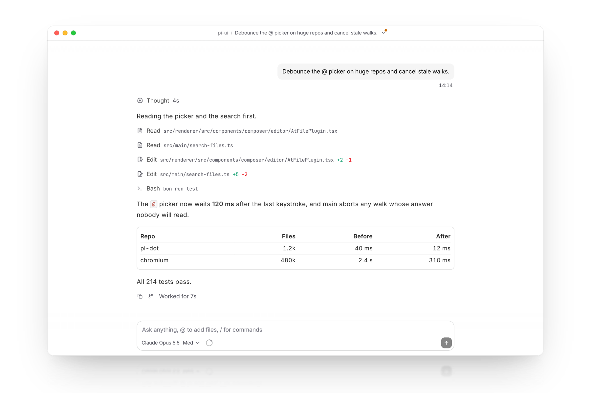
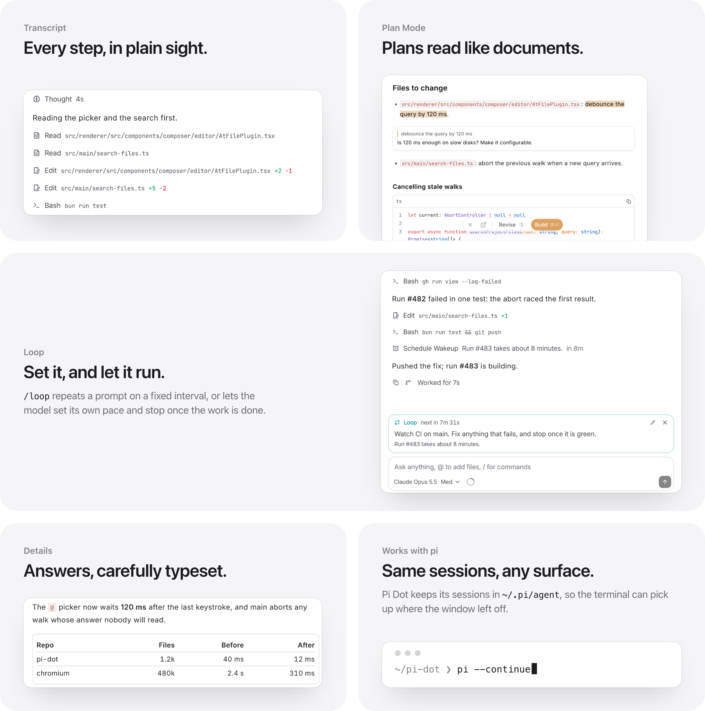

  

<h1 align="center">Pi Dot</h1>

A beautifully designed desktop app for the <a href="https://github.com/earendil-works/pi">pi</a> coding agent.

  <picture>
    <source media="(prefers-color-scheme: dark)" srcset="docs/hero-dark.png" />
    
  </picture>

- **A polished interface**: consistent dark and light themes, restrained typography, careful details.
- **Plan mode**: the plan arrives as a document. Select text to comment, then build with one click.
- **Loop mode**: `/loop` repeats a prompt on a fixed interval, or lets the model pace itself and stop when the work is done.
- **Works with `pi`**: shares configuration and sessions in `~/.pi/agent`, so you can pick up the same session in the terminal or the desktop.

  <picture>
    <source media="(prefers-color-scheme: dark)" srcset="docs/features-dark.png" />
    
  </picture>

> Early development. No packaged releases yet.

## License

[MIT](LICENSE)
